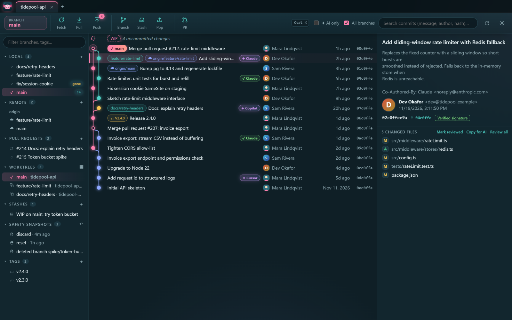
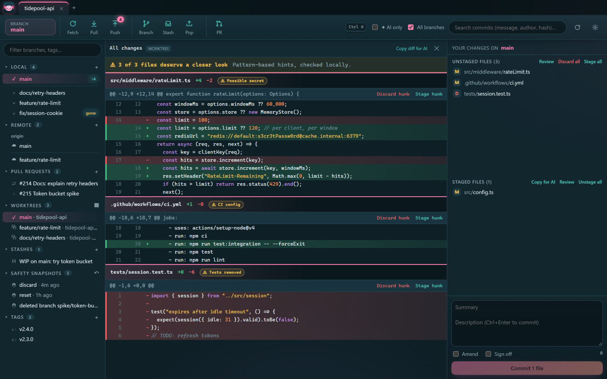
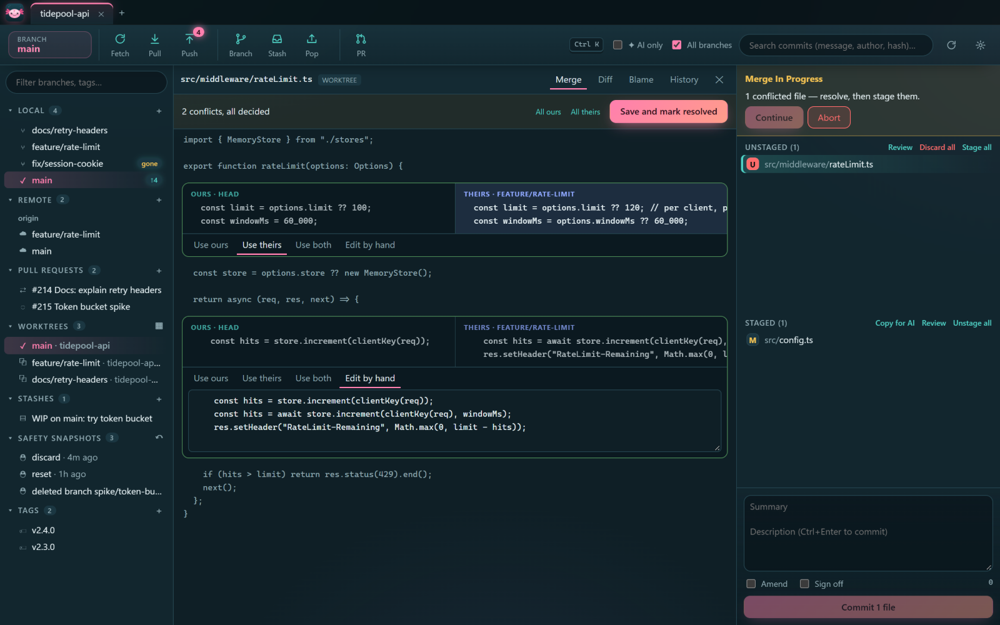
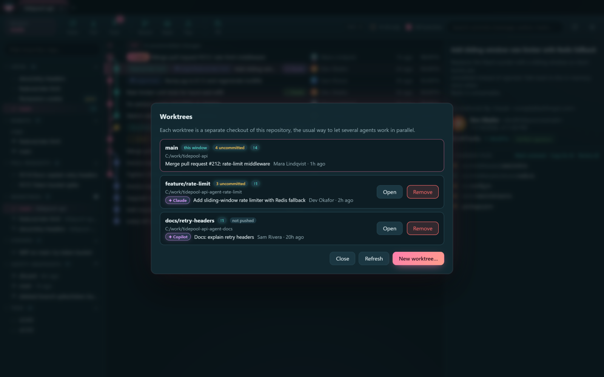
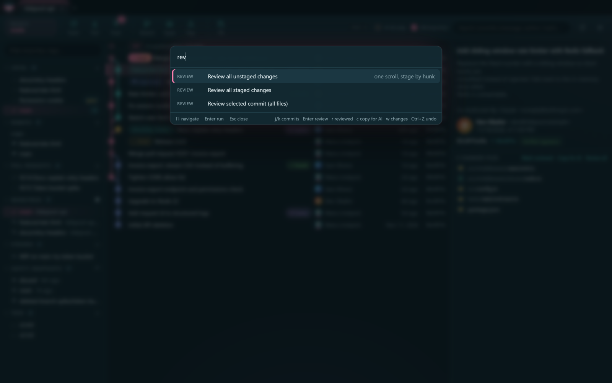
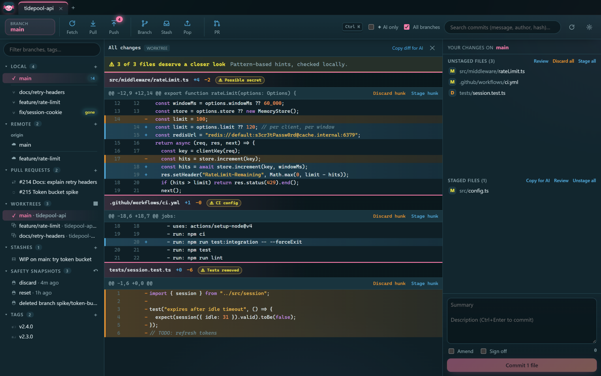

<div align="center">


# Gitolotl

### The Git client for reviewing AI-written code

A fast, friendly, **open-source** Git GUI for **Windows, macOS and Linux** with an undo for every destructive action.<br />
Made by [CodeMushroom](https://github.com/CodeMushroom).

[](https://github.com/CodeMushroom/Gitolotl/releases/latest)
[](https://github.com/CodeMushroom/Gitolotl/releases)

[](LICENSE)

### [⬇ Download Gitolotl](https://github.com/CodeMushroom/Gitolotl/releases/latest)

</div>



## Why Gitolotl

Coding agents write a lot of your commits now. Gitolotl is built around the job that leaves you with:
**seeing what changed, deciding what to keep, and being able to take anything back.**

### Review what the agent did, fast

Every file of a change in one scroll. Stage, unstage or discard by hunk or by single line. Files that
deserve a closer look are flagged: possible secrets, CI configuration, dependency and lockfile changes,
migrations, auth code, removed tests.



- Commits written with **Claude, Copilot, Cursor, Codex** and others are badged in the graph
- Mark commits as reviewed; Gitolotl reminds you before you push ones you have not
- **Copy for AI**: any diff to your clipboard as a ready-to-paste block

### Undo anything

Before Gitolotl discards changes, resets, rebases, amends, or deletes a branch, tag or stash, it saves
what is about to be lost. **`Ctrl+Z` brings it back.** Snapshots are ordinary Git refs, so they work even
without Gitolotl, and it never changes a repository unless you ask.

### Resolve conflicts without leaving the app

Each conflict side by side: take ours, theirs, both, or edit by hand.



### Run agents in parallel and keep track

The worktree dashboard shows every checkout: its branch, uncommitted work, what is unpushed, and which
agent committed last.



### Keyboard first

`Ctrl+K` opens a command palette for every action, branch, tag and commit. `j` / `k` move through
history, `Enter` reviews, `r` marks reviewed.



## Everything else you expect

- Commit graph with branches, tags, remotes and search
- Diffs with syntax colouring, blame and file history
- Branches, tags, stashes, merge, rebase, **interactive rebase**, cherry-pick, revert, reset
- Fetch, pull, push, and force-push that refuses to overwrite a teammate's work
- GitHub pull requests: list, open and check out
- Several repositories in tabs
- Author pictures: set your own, or opt in to GitHub and Gravatar pictures
- Built-in, signed auto-updates with a reminder when a new version is out

## Accessible

Settings has colour presets for red-green and blue-yellow colour blindness and a high-contrast mode.
Diffs always carry `+` / `−` signs and status badges carry letters, so nothing depends on colour alone.



## Private and safe by design

- **No account, no telemetry.** Gitolotl talks to your Git remotes and, for pull requests, to GitHub.
  That is all.
- **Never stores your credentials.** Sign-in is handled by your own Git credential helper or SSH agent.
- **Looking never writes.** Browsing history and diffs cannot modify your repository or interfere with
  other tools working in it.
- **Signed updates.** Every update is cryptographically signed by CodeMushroom and verified before it is
  installed.

## Install

Open the **[latest release](https://github.com/CodeMushroom/Gitolotl/releases/latest)** and use the download
table at the top of that page. You only need one file:

| Your computer | The file that ends in |
| --- | --- |
| **Windows** | `Windows-setup.exe` |
| **Mac with Apple silicon** (M1 or newer) | `Mac-AppleSilicon.dmg` |
| **Mac with Intel** | `Mac-Intel.dmg` |
| **Linux**, any distribution | `Linux.AppImage` |
| **Linux**, Debian / Ubuntu | `Linux.deb` |
| **Linux**, Fedora / RHEL | `Linux.rpm` |

You need `git` 2.31 or newer installed. Everything else attached to a release (`.sig`, `.app.tar.gz`,
`latest.json`) is for the built-in updater and can be ignored.

The installers are not yet signed with a Windows or Apple certificate, so the first launch shows a
warning. On Windows choose **More info → Run anyway**; on macOS right-click the app and choose **Open**.

## Questions

**Does it replace the Git command line?** It runs your installed `git` for every operation, so it works
with your existing configuration, hooks, credentials and SSH keys, and you can switch between Gitolotl
and the terminal freely.

**Does my code go anywhere?** No. Nothing is uploaded. "Copy for AI" only puts text on your clipboard.

**Which AI tools does it recognise?** Any commit whose author or `Co-authored-by` line names Claude,
GitHub Copilot, Cursor, Codex, Gemini, Devin, Aider, Windsurf, Amazon Q, or a bot account.

**Is it free and open source?** Yes. Gitolotl is free, and its source is in this repository under the
[Apache License 2.0](LICENSE). You can read exactly what it does with your repositories and credentials.

## Build it yourself

You need Node 22+, npm 11+, Rust (stable), `git`, and the
[Tauri prerequisites](https://tauri.app/start/prerequisites/) for your platform.

```bash
npm install
```

```bash
npm run tauri dev
```

- [User guide](docs/USER_GUIDE.md): every feature and keyboard shortcut
- [Safety](docs/SAFETY.md): what protects your repository, and how to recover anything
- [Architecture](docs/ARCHITECTURE.md): how the code is laid out and the security model
- [Releasing](docs/RELEASING.md): installers, the auto-updater, signing
- [Contributing](CONTRIBUTING.md): how to send a change

## Feedback

Found a bug or want a feature? [Open an issue](https://github.com/CodeMushroom/Gitolotl/issues/new/choose).
If Gitolotl saves you time, a ⭐ on this repository helps other developers find it.

---

<div align="center">

Gitolotl is made by **[CodeMushroom](https://github.com/CodeMushroom)**. Copyright © 2026 CodeMushroom.

Licensed under the [Apache License 2.0](LICENSE). Forks must keep the [NOTICE](NOTICE) crediting CodeMushroom.<br />
The Gitolotl name and axolotl logo are CodeMushroom trademarks: see [TRADEMARKS.md](TRADEMARKS.md).

</div>
