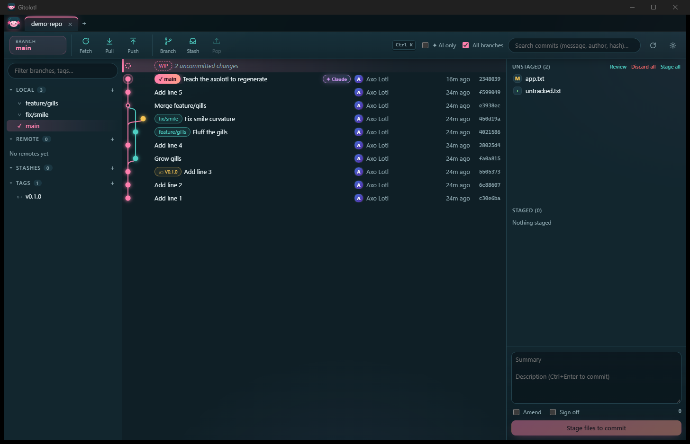

# Gitolotl

**A friendly, secure Git client for Windows, macOS and Linux, by [CodeMushroom](https://github.com/CodeMushroom).**

Built for developers who review and steer a lot of AI-written code.

### [Download the latest release »](https://github.com/CodeMushroom/Gitolotl/releases/latest)

## Install

Open the **[latest release](https://github.com/CodeMushroom/Gitolotl/releases/latest)** and use the download
table at the top of that page. You only need one file:

| Your computer | The file that ends in |
| --- | --- |
| **Windows** | `x64-setup.exe` |
| **Mac with Apple silicon** (M1 or newer) | `aarch64.dmg` |
| **Mac with Intel** | `x64.dmg` |
| **Linux**, any distribution | `.AppImage` |
| **Linux**, Debian / Ubuntu | `.deb` |
| **Linux**, Fedora / RHEL | `.rpm` |

Everything else attached to a release (`.sig`, `.app.tar.gz`, `latest.json`) is for the built-in updater and
can be ignored.

You need `git` 2.31 or newer installed.

The installers are not yet signed with a Windows or Apple certificate, so the first launch shows a
warning. On Windows choose **More info → Run anyway**; on macOS right-click the app and choose **Open**.

## Updates

Gitolotl checks this repository for a new version when it starts and asks before installing it. Every
update is cryptographically signed by CodeMushroom and verified by the app before it is applied.

## What it does

- Commit graph, staging by file and by hunk, diffs, blame and file history
- Branches, tags, stashes, worktrees, merge, rebase, interactive rebase, cherry-pick, revert, reset
- Conflict handling, remotes, force-push with lease, GitHub pull requests
- **AI-aware**: badges on commits written with Claude, Copilot, Cursor, Codex and others; review every
  file of a change in one scroll; copy any diff straight into an AI chat
- Command palette (`Ctrl+K`) and keyboard navigation

## Safe by design

- Gitolotl never changes a repository unless you ask it to.
- Anything it destroys at your request (discarded changes, hard resets, deleted branches, dropped
  stashes, rewritten history) is saved first as a **safety snapshot** you can restore.
- It never stores your credentials; sign-in is handled by your own git credential helper.

## About this repository

This repository hosts Gitolotl's installers and update files. The source code is developed privately.

## Credits

Gitolotl is made by **CodeMushroom**.

Copyright © 2026 CodeMushroom. All rights reserved.
